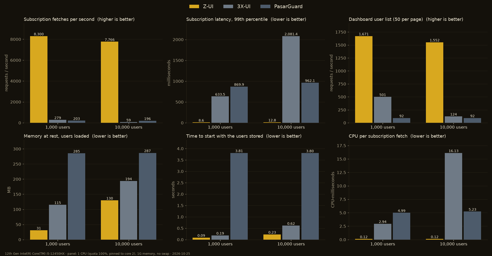

<div align="center">

# Z-UI

**A control panel for [zray-core](https://github.com/ZeroNetTeam/Zray-Core)**
· پنل مدیریت برای zray-core

</div>

Z-UI manages a zray-core server the way 3X-UI and PasarGuard manage Xray:
inbounds, users with traffic, time, device and speed limits, subscriptions,
admins and resellers, bots and backups, in one Rust binary with the web
dashboard inside. See [ROADMAP.md](ROADMAP.md) for the plan (in Persian).

> **Status:** beta (v0.2.0-beta.4). Usable, still changing; not yet advised for production.

It also watches the server and tells the admins (Telegram, Discord, webhook):
CPU, memory, disk or temperature over a limit, every N GB of traffic the panel
carries (1 TB by default), a reboot, and users that ran out of data or time.
Optionally, under sustained load it can lighten the server by itself: users that
are connected but idle leave the core for a few minutes and the heaviest ones
are slowed, then everything goes back. It is off until an admin turns it on.

## Performance

A panel is a small program on a small server, so it was measured as one: each
panel alone in **1 CPU and 1 GB** (no swap), with the same job, one VLESS
inbound and *N* users that each have a subscription link, against the two
panels it replaces, [3X-UI](https://github.com/MHSanaei/3x-ui) 3.10.2 and
[PasarGuard](https://github.com/PasarGuard/panel) 5.4.1, built from their own
sources. The load is [oha](https://github.com/hatoo/oha) on other cores.



**10,000 users**

| | Z-UI | 3X-UI | PasarGuard |
|---|---:|---:|---:|
| Subscription fetches / s | **7,766** | 59 | 196 |
| Subscription latency, median / 99th % | **8.0 / 13 ms** | 1,094.7 / 2,081 ms | 302.9 / 962 ms |
| CPU per subscription fetch | **0.12 ms** | 16.13 ms | 5.23 ms |
| Dashboard user list / s | **1,552** | 124 | 92 |
| Memory at rest | **130 MB** | 194 MB | 287 MB |
| Memory, peak under load | **142 MB** | 675 MB | 321 MB |
| Idle CPU | 0.5% | 18.7% | 0.6% |
| Start, users stored | **0.23 s** | 0.62 s | 3.80 s |

**1,000 users**

| | Z-UI | 3X-UI | PasarGuard |
|---|---:|---:|---:|
| Subscription fetches / s | **8,300** | 279 | 203 |
| Subscription latency, median / 99th % | **7.7 / 9 ms** | 213.0 / 633 ms | 294.3 / 870 ms |
| CPU per subscription fetch | **0.12 ms** | 2.94 ms | 4.99 ms |
| Dashboard user list / s | **1,671** | 501 | 92 |
| Memory at rest | **31 MB** | 115 MB | 285 MB |
| Memory, peak under load | **34 MB** | 155 MB | 312 MB |
| Idle CPU | 0.4% | 2.5% | 0.8% |
| Start, users stored | **0.09 s** | 0.19 s | 3.81 s |

What to keep in mind: Z-UI's figures **include its proxy core**, which runs in
the same process with all the users loaded, while the other two's cores are
separate programs this test does not start, so the comparison leans toward them
on memory. All three were on SQLite, their default. It is one machine and one
run per figure. How it was done, what is and is not alike, and how to repeat it
is in [bench/](bench/README.md); the raw numbers are in
[bench/results/latest.json](bench/results/latest.json).

The Z-UI measured is `main` with the three fixes this benchmark found in it
(SQLite was syncing the disk on every commit, a subscription fetch wrote the
database every time, and the user list read every user to count them).

## Installing

On a Linux server (Ubuntu, Debian, CentOS/Rocky/Alma, Fedora or Arch; x86_64
or aarch64), as root:

```sh
bash <(curl -Ls https://github.com/ZeroNetTeam/Z-UI/releases/latest/download/install.sh)
```

It asks a few questions (or take them all as flags, see `--help`), then checks
the server, downloads the release and checks its hash and signature, makes a
random port, secret path and admin, can turn on BBR and time sync and open the
firewall, can get an HTTPS certificate for a domain (or this server's address),
and starts Z-UI as a systemd service. At the end it prints the address and the
sign-in.

```sh
bash install.sh --yes --domain panel.example.com --email me@example.com   # no questions, with HTTPS
bash install.sh --yes --domain panel.example.com --cert-method dns-01 --cloudflare-token …   # behind Cloudflare
```

Afterwards `z-ui` is the menu: start, stop, restart, status, logs, update,
roll back, change the port or the path, get a certificate, reset a password or
two-factor sign-in, back up and restore, uninstall. Run it again to update. If
GitHub is closed from the server, give `--proxy socks5://…` or `--mirror URL`.

**Updates** can also be made from the panel (Settings → Updates). Every
release is signed; the panel downloads the release, checks the signature on its
checksums and the archive against them, starts the new program once to see
that it is the version it says, and only then puts it in place, keeping the old
one (`z-ui update rollback`).

### Docker

```sh
docker compose up -d        # docker-compose.yml: host networking, data in ./data
```

or `docker run -d --network host -v $PWD/data:/data -e ZUI_ADMIN_USER=admin -e ZUI_ADMIN_PASSWORD=… ghcr.io/zeronetteam/z-ui`.
A container is updated by pulling a new image, not from the panel.

### Certificates and the panel's address

Certificates are got from Let's Encrypt (or its staging server, ZeroSSL, or any
ACME authority) by the panel itself, with an HTTP challenge on port 80, a TLS
challenge on 443, or a DNS challenge through Cloudflare (for wildcards and for
domains behind a CDN); an address gets a short-lived certificate. They renew
themselves before they expire, and the panel and the inbounds take the new one
without a restart. The panel's own port, secret path and HTTPS certificate are
set under Settings, or with `z-ui setting show|set|reset`; whatever a flag or a
`ZUI_*` variable fixed is shown there as fixed.

## Building

Z-UI builds against a checkout of zray-core next to it:

```sh
git clone https://github.com/ZeroNetTeam/Zray-Core resources/zray-core
make            # dashboard (npm) + release binary: target/release/z-ui
```

A zray-core checkout elsewhere works too: link it there with
`ln -s /path/to/zray-core resources/zray-core`.

Rust 1.95+ and Node 22+ are needed. `cargo build` alone also works: without a
built dashboard the binary serves a page saying how to build one.

## Running

```sh
./target/release/z-ui --listen 0.0.0.0:2053 --base-path /my-secret-path
```

| Flag | Variable | Default | |
|---|---|---|---|
| `--listen` | `ZUI_LISTEN` | `0.0.0.0:2053` | Address of the panel; given here, it is fixed and cannot be changed from the panel |
| `--base-path` | `ZUI_BASE_PATH` | `/` | The panel answers only under this path, 404 elsewhere; fixed the same way |
| `--data-dir` | `ZUI_DATA_DIR` | `data` | Database and core files |
| `--database-url` | `ZUI_DATABASE_URL` | `sqlite://<data-dir>/z-ui.db` | Or `postgres://…` |
| `--cert`, `--key` | `ZUI_CERT_FILE`, `ZUI_KEY_FILE` | | Serve HTTPS with this PEM certificate chain and key |

Logging follows `ZUI_LOG` (e.g. `ZUI_LOG=debug`). A fresh panel started with
`ZUI_ADMIN_USER` and `ZUI_ADMIN_PASSWORD` makes that admin at once (for a
container with no terminal).

The same program has commands for the server: `z-ui admin create|list|reset-password`,
`z-ui setting show|set|reset`, `z-ui cert list|issue|renew|self-signed`,
`z-ui update check|apply|rollback`, `z-ui backup`, `z-ui restore FILE`,
`z-ui migrate FROM [--apply]` (bring over the users, inbounds and quota of
3X-UI, PasarGuard or Marzban from their database; their subscription links keep
working), `z-ui takeover status|rollback|delete-old` and `z-ui health`.

To replace a 3X-UI or PasarGuard that is installed on the same server, run the
installer with `--replace`: their users, inbounds and settings move over, users
reconnect by themselves within seconds, the old panel's files stay (stopped) for a
week, and "I made a mistake" (in the panel, or `z-ui takeover rollback`) brings the old
panel back with everything its users used meanwhile.

### First start

A new panel has no admin. Whoever reached it first could otherwise claim it,
so the first admin can only be created from a one-time link printed in the
log:

```text
WARN no admin yet; create one at http://0.0.0.0:2053/my-secret-path/setup?token=…
```

### Locked out

From the server itself:

```sh
./z-ui admin reset-password admin                 # prints a new random password
./z-ui admin reset-password admin --disable-2fa   # for a lost authenticator
```

Sign-in is limited to 5 failures per address and 20 per username in 15
minutes; sessions last 24 hours and end on a password change.

## Layout

| Path | |
|---|---|
| `crates/z-panel` | The `z-ui` binary: HTTP API and the embedded dashboard |
| `crates/z-node` | The `Node` trait the panel drives; `LocalNode` runs the core in-process |
| `crates/z-db` | SQLite / PostgreSQL storage and migrations |
| `crates/z-common` | Types shared by the panel and nodes |
| `dashboard/` | React + Tailwind dashboard (Persian RTL and English) |

## Development

```sh
make dev     # panel on :2053, Vite on :5173 with hot reload
make test    # Rust and dashboard tests
make lint    # rustfmt, clippy, TypeScript
```

## License

GPL-3.0-or-later (see `LICENSE`). Some dashboard files are adapted from
PasarGuard and keep its AGPL-3.0 terms; [NOTICE.md](NOTICE.md) says which
and what that means. zray-core itself is MIT.
